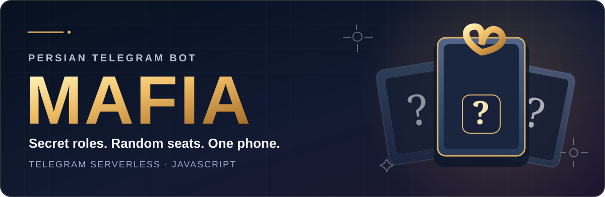
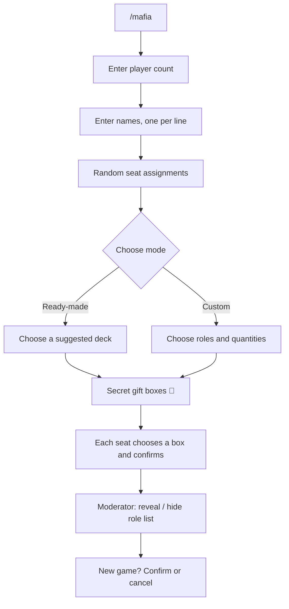

<div align="center">



<br />

**A little mystery. A lot less setup.**  
A Persian-language Mafia role distributor, built for **Telegram Serverless** and **one shared phone**.

<br />


<br /><br />

[Features](#-features) · [How it works](#-how-it-works) · [Quick start](#-quick-start) · [فارسی](#-راهنمای-فارسی) · [Contributing](#-contributing)

</div>

---

## ✨ Features

| | Feature | What it does |
|:--:|---|---|
| 👥 | **Player registration** | Accepts **2–30 players**, one name per line, with count and duplicate checks. |
| 🪑 | **Random seating** | Assigns each player a random seat number before the game. |
| 🎲 | **Ready-made games** | Three suggested role decks that adjust to the player count (**5–30 players**). |
| ⚙️ | **Custom games** | Choose from **40 roles** across citizens, Mafia, and independent characters. |
| 🎁 | **Secret gift boxes** | Every unopened box looks the same; players choose in **seat order**. |
| 🙈 | **Hide after reading** | Each player taps **«متوجه شدم»** to conceal their role before passing the phone on. |
| 🔐 | **Moderator controls** | Reveal or hide the final seat/name/role list on demand. |
| 🔄 | **Safe restart** | Starting a new game requires confirmation, with a cancel option. |

> **No Mini App and no separate hosting required.** The backend is a handful of JavaScript modules deployed to Telegram Serverless.

## 🎮 How it works



### A look at the experience

**Players receive their roles in seat order.** Numbered seats identify the player, but the unopened buttons themselves have **no visible numbers**:

```text
🎁 نوبت صندلی ۲: بازیکن دوم

گوشی را به این بازیکن بدهید تا یکی از
جعبه‌های باقی‌مانده را انتخاب کند.

       [ 🎁 ]   [ 🎁 ]   [ 🎁 ]
       [ 🎁 ]   [ 🎁 ]   [ 🎁 ]

       ...tap a box to reveal a role...

             [ ✅ متوجه شدم ]
```

The player confirms, their role is edited out of the message, and the phone passes to the next seat. After the last player, the moderator sees **«🔐 نمایش لیست نقش‌ها»**—not the list itself. The moderator can show/hide it and can start a new game **only after confirming**.

## 🚀 Quick start

### Requirements

- **Node.js 18+** and npm
- A Telegram bot created with [@BotFather](https://t.me/BotFather)
- **Telegram Serverless access** enabled for that bot
- The Telegram Serverless CLI (`@tgcloud/cli`), installed by the project creator

### 1 · Get the project

Clone this repository using GitHub’s **Code → Copy URL** button, then enter the cloned folder:

```bash
# Example: replace the URL with the one from your repository's Code button
git clone https://github.com/madi-un/mafia-telegram-serverless.git
cd mafia-telegram-serverless
```

If this repository includes a `package.json`, install its dependencies:

```bash
npm install
```

If you downloaded **only the `tgcloud/` source files**, create the local CLI/project files in that folder instead:

```bash
npm create @tgcloud/bot .
```

> Already have another Telegram Serverless bot? **Merge** these `tgcloud/` handlers, library functions, and schema with your existing project—do not blindly overwrite its modules.

### 2 · Enable Serverless and sign in

In **@BotFather → your bot → Serverless**, enable the feature. Then find **CLI Access → Access token**.

```bash
npx tgcloud login
```

Paste the **Serverless CLI access token** when prompted. This is **not** your regular Bot API token. Never commit either token to GitHub.

### 3 · Deploy

From the project root:

```bash
npx tgcloud status     # review what will be deployed
npx tgcloud push       # deploy JavaScript modules
npx tgcloud migrate    # review/apply schema changes (mafia_games table)
npx tgcloud webhook    # check webhook status
```

If the webhook is **out of sync** and no other backend depends on it, run:

```bash
npx tgcloud webhook sync
```

**Important:** A full `push` makes Telegram’s deployed modules match your local `tgcloud/` directory. If you already run other handlers, bring them into your local project first so they are not deleted remotely.

### 4 · Play

Open a **private chat** with your bot and send:

```text
/mafia
```

Enter the number of players, paste their names on separate lines, and follow the Persian buttons. The moderator passes the phone to players according to their assigned seat order.

> [Telegram Serverless documentation](https://blogfork.telegram.org/bots/serverless) · [Telegram Bot API](https://core.telegram.org/bots/api)

## 🎭 Game modes

### 🎲 مافیای آماده — Ready-made

Choose from three **suggested**, adaptable decks:

| Deck | Character of the game |
|---|---|
| 🎲 **کلاسیک ساده** | Core roles: Godfather, Mafia, Doctor, Detective, Citizens. |
| 🕵️ **کلاسیک نقش‌دار** | Adds special Citizen roles such as جان‌سخت and حرفه‌ای. |
| 🌙 **شب‌های مافیا (پیشنهادی)** | Includes extra roles such as دکتر لکتر, روان‌پزشک, and شهردار. |

The bot previews the **exact number of each role** before the moderator confirms. Presets are designed for **5–30 players**, with approximately one-third Mafia members. They are helpful suggestions, **not official scenario rulesets**.

### ⚙️ مافیای دلخواه — Custom

The moderator chooses each role and its quantity. The bot makes sure that the total number of roles exactly matches the player count.

| Team | Roles available |
|---|---:|
| 🟢 Citizens / شهروندان | 20 |
| 🔴 Mafia / مافیا | 14 |
| 🟡 Independent / مستقل | 6 |
| **Total** | **40** |

All role names, categories, and ready-made presets live in [`tgcloud/lib/mafia.js`](tgcloud/lib/mafia.js), making them easy to customize.

## 🇮🇷 راهنمای فارسی

<div dir="rtl">

**تقسیم نقش مافیا** یک ربات فارسی برای مدیریت تقسیم نقش در بازی مافیاست؛ بدون نیاز به سرور شخصی یا مینی‌اپ.

**مراحل بازی:**

۱. در چت خصوصی ربات دستور <code>/mafia</code> را بفرستید.  
۲. تعداد بازیکنان را وارد کنید و نام هر نفر را در یک خط جداگانه بنویسید.  
۳. ربات شماره صندلی‌ها را به‌صورت تصادفی مشخص می‌کند.  
۴. حالت **مافیای آماده** یا **مافیای دلخواه** را انتخاب کنید.  
۵. بازیکنان به‌ترتیب صندلی، یکی از جعبه‌های 🎁 را انتخاب می‌کنند و با زدن **«✅ متوجه شدم»** نقش خود را پنهان می‌کنند.  
۶. در پایان، گرداننده می‌تواند با دکمه مخصوص، لیست نقش‌ها را **نمایش** یا **مخفی** کند.  
۷. برای شروع بازی جدید، ابتدا باید درخواست را **تأیید** کنید.

**توجه:** فقط یک بازی جاری برای هر چت خصوصی ذخیره می‌شود. با تأیید شروع بازی جدید، اطلاعات بازی قبلی جایگزین خواهد شد.

</div>

## 🗂️ Project structure

```text
tgcloud/
├── handlers/
│   ├── message.js          # Commands, player count, names, role quantities
│   └── callback_query.js   # Inline buttons, gift boxes, moderator controls
├── lib/
│   └── mafia.js            # Roles, decks, shuffling, helpers, database access
└── schema.js               # Persistent game state (mafia_games)
```

The game uses Telegram Serverless’s built-in SQLite-backed database. There is **one active game per private chat**. Confirming a new game overwrites that game’s saved state; **game history is not implemented**.

## 🔒 Privacy & limitations

- The bot is designed for **one device shared in person**; it does not verify who is holding the phone.
- Editing the message hides a role in the chat view, but **cannot prevent screenshots, notifications, or other clients from retaining it**.
- Anyone holding the phone can access the moderator reveal button—**there is no moderator PIN**.
- The bot distributes characters; it does **not** run night actions, voting, or win-condition logic.
- Player names and current assignments are stored in your bot’s Telegram Serverless database. They are **not** part of this source repository.
- Never commit `.tgcloud/`, bot tokens, `.env` files, or private screenshots.

## 🛣️ Roadmap

- [x] Random seat assignment
- [x] 40-role catalog and ready-made decks
- [x] Unnumbered mystery boxes
- [x] Reveal/hide moderator list
- [x] Confirm before starting a new game
- [ ] Optional game history
- [ ] Optional moderator PIN
- [ ] More community-created scenario presets

Ideas and bug reports are welcome through **GitHub Issues**.

## 🤝 Contributing

Contributions are welcome—especially fixes for Persian text, new role descriptions, and scenario presets. To contribute, **fork** the repository, create a branch, make your change, and open a **pull request** explaining what you changed and how you tested it.

For scenario changes, remember that rules differ between Mafia communities; please describe which variant inspired your proposed preset.

## 📄 License

If you want others to reuse and modify this code, **add an open-source license before publishing**. A permissive option is the **MIT License**. This project kit includes `LICENSE.template`: replace `YOUR_NAME_OR_GITHUB_USERNAME` with your preferred copyright name and rename the file to `LICENSE`.

---

<div align="center">

**Made for long Mafia nights 🌙**  
<sub>Not affiliated with or endorsed by Telegram. Role presets are suggestions, not official rules.</sub>

</div>
